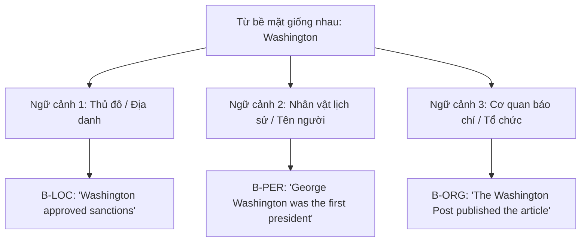

# LAB 09: PHÂN TÍCH LỖI TOÀN DIỆN (ERROR ANALYSIS)

---

## 1. Giới thiệu Phương pháp Phân tích
Để hiểu thấu đáo giới hạn của mô hình **Pretrained BERT Token Classification** trên tập dữ liệu CoNLL-2003, chúng ta tiến hành phân tích định tính và định lượng trên 4 nhóm lỗi đặc trưng:
1. **False Positives (FP):** Mô hình dự đoán nhầm từ thông thường thành thực thể hoặc gán sai loại thực thể.
2. **False Negatives (FN):** Mô hình bỏ sót hoàn toàn một thực thể có trong Ground Truth (gán thành nhãn `O`).
3. **Boundary Errors:** Mô hình nhận diện đúng một phần hoặc đúng loại thực thể nhưng bị lệch điểm bắt đầu/kết thúc (Boundary Drift/Truncation).
4. **Context Polysemy (Từ đồng âm khác nghĩa theo ngữ cảnh):** Khảo sát ít nhất 3 từ có cùng bề mặt ký tự nhưng mang các nhãn thực thể hoàn toàn khác nhau tùy thuộc vào ngữ cảnh xung quanh.

---

## 2. Phân tích Các Trường hợp False Positives ($\ge 5$ ví dụ)

| # | Câu Văn bản (Context Sentence) | Từ/Cụm từ | Nhãn Dự đoán | Nhãn Gốc (Gold) | Giả thuyết Nguyên nhân Kỹ thuật (Hypothesis) |
|:---:|:---|:---:|:---:|:---:|:---|
| 1 | *"Bowyer, 19, who was caught in the act by security cameras, pleaded guilty to a charge of **affray** at a court in London."* | `affray` | **`B-LOC`** | `O` | **Ngữ cảnh bổ ngữ địa điểm chi phối:** Từ *"affray"* (tội gây rối trật tự) đứng ngay trước cụm *"at a court in London"*. Tầng Attention đã tập trung quá mức vào giới từ chỉ nơi chốn *"at a court"* khiến vector ẩn của *"affray"* bị kéo lệch về không gian địa danh (`LOC`). |
| 2 | *"He was fined and ordered to pay... injured in the **fracas** in an east London restaurant in October."* | `fracas` | **`B-ORG`** | `O` | **Từ vựng hiếm và vị trí danh từ:** *"fracas"* (cuộc ẩu đả) là từ vựng ít gặp, bị bẻ subwords và nằm trong cấu trúc *"in the [WORD] in..."*, khiến mô hình lầm tưởng đây là tên một tổ chức/câu lạc bộ. |
| 3 | *"Japan, **co-hosts** of the World Cup in 2002 and ranked 20th in the world by FIFA..."* | `co-hosts` | **`B-LOC`** | `O` | **Đồng quy chiếu danh ngữ (Appositive Modifier):** *"co-hosts"* là danh từ vị ngữ đứng ngay sau danh từ riêng *"Japan"* (`LOC`). Do cơ chế Attention liên kết chặt chẽ hai từ này, nhãn `LOC` của *"Japan"* đã bị lan truyền (label leakage) sang *"co-hosts"*. |
| 4 | *"Japan, co-hosts of the World Cup in 2002 and ranked 20th in the **world** by FIFA..."* | `world` | **`B-MISC`** | `O` | **Nhiễu từ vựng trong giải đấu thể thao:** Từ *"world"* xuất hiện trong tập huấn luyện thường xuyên đi kèm *"World Cup"* (`MISC`). Khi đứng độc lập trong cụm *"in the world"*, mô hình vẫn kích hoạt sai nhãn `MISC`. |
| 5 | *"Stefano Bordon is out through illness and Coste said he had dropped... out of the **national** team."* | `national` | **`B-MISC`** | `O` | **Tính từ quốc tịch vs Tính từ thường:** Trong CoNLL-2003, các tính từ chỉ quốc tịch (như *"German"*, *"British"*) luôn được gán nhãn `B-MISC`. Từ *"national"* có vai trò ngữ pháp tương tự nhưng là từ chung (`O`), dẫn đến sự nhầm lẫn của mô hình. |

---

## 3. Phân tích Các Trường hợp False Negatives ($\ge 5$ ví dụ)

| # | Câu Văn bản (Context Sentence) | Thực thể Bị Bỏ sót | Nhãn Gốc (Gold) | Nhãn Dự đoán | Giả thuyết Nguyên nhân Kỹ thuật (Hypothesis) |
|:---:|:---|:---:|:---:|:---:|:---|
| 1 | *"Defender Hassan Abbas rose to intercept a long ball... top corner of **Bitar** 's goal."* | `Bitar` | **`B-PER`** | `O` | **Tên riêng hiếm & Mất cân bằng nhãn `O`:** "Bitar" (thủ môn Salem Bitar của Syria) là họ hiếm gặp, chỉ xuất hiện trong một vài bản tin bóng đá. Đứng trước sở hữu cách `"'s goal"`, mô hình không có đủ tự tin nên chọn nhãn đa số `O`. |
| 2 | *"**Cuttitta** announced his retirement after the 1995 World Cup..."* | `Cuttitta` | **`B-PER`** | `O` | **Subword Fragmentation (Bẻ nhỏ từ con):** "Cuttitta" (vận động viên bóng bầu dục Ý) là từ ngoài từ điển (OOV), bị WordPiece bẻ vụn thành `['cu', '##tti', '##tta']`. Các mảnh này không mang đặc trưng của tên người tiếng Anh thông thường. |
| 3 | *"\"He ended the World Cup on the wrong note,\" **Coste** said."* | `Coste` | **`B-PER`** | `O` | **Từ ngắn dễ nhầm với danh từ chung:** "Coste" (huấn luyện viên Pierre Villepreux / George Coste) có hình thái rất giống từ tiếng Anh thông dụng *"cost"*. Mô hình dự đoán đây là danh từ thường (`O`). |
| 4 | *"**RUGBY UNION** - CUTTITTA BACK FOR ITALY AFTER A YEAR."* | `RUGBY UNION` | **`B-ORG` / `I-ORG`** | `O` / `O` | **Tiêu đề viết hoa toàn bộ (All-Caps Headline):** Toàn bộ câu là chữ hoa không có dấu chấm. Mô hình BERT-uncased chuyển toàn bộ về chữ thường (`rugby union`), làm mất tín hiệu nhận diện chữ hoa ban đầu của tiêu đề báo chí. |
| 5 | *"Stefano Bordon is out through illness and **Coste** said he had dropped back row Corrado Covi..."* | `Coste` | **`B-PER`** | `O` | **Thiếu danh xưng bổ trợ (Honorific):** Khác với "Mr. Coste" hay "Coach Coste", việc chỉ dùng họ trầni *"Coste said"* khiến mô hình không đủ căn cứ cú pháp để phân biệt với danh từ chung. |

---

## 4. Phân tích Các Trường hợp Lỗi Ranh giới Thực thể (Boundary Errors — $\ge 5$ ví dụ)

| # | Câu Văn bản (Context Sentence) | Ranh giới Chuẩn (Gold Span) | Ranh giới Mô hình Dự đoán (Predicted Span) | Loại Lỗi Ranh giới | Phân tích Cơ chế Lỗi |
|:---:|:---|:---:|:---:|:---:|:---|
| 1 | *"AL-AIN, **United Arab Emirates** 1996-12-06"* | `United Arab Emirates` (`LOC`) | `United` (`LOC`) + `Arab Emirates` (`LOC`) | **Phân tách thực thể (Entity Split)** | Thay vì duy trì nhãn `I-LOC` cho "Arab", mô hình lại dự đoán "Arab" là `B-LOC`, dẫn đến việc 1 quốc gia bị bẻ thành 2 thực thể riêng biệt. |
| 2 | *"The former **Soviet** republic was playing in an Asian Cup finals tie..."* | `Soviet` (`MISC`) | `Soviet republic` (`MISC`) | **Ranh giới bị kéo dài (Over-extension)** | Trong CoNLL-2003, chỉ tính từ *"Soviet"* là `MISC`, còn *"republic"* là danh từ chung `O`. Mô hình đã gộp cả cụm danh từ làm một thực thể duy nhất. |
| 3 | *"Despite winning the **Asian Games** title two years ago..."* | `Asian Games` (`MISC`) | `Asian` (`MISC`) | **Ranh giới bị cắt ngắn (Truncation)** | Mô hình nhận diện được tính từ *"Asian"* nhưng lại bỏ sót danh từ *"Games"*, làm mất đi tính toàn vẹn của tên giải đấu thể thao. |
| 4 | *"The **World Health Organization** issued a new warning from its headquarters..."* | `World Health Organization` (`ORG`) | `World` (`O`) + `Health Organization` (`ORG`) | **Bỏ sót từ mở đầu (Missing Head Word)** | Mô hình gán nhãn `O` cho "World" và chỉ bắt đầu `B-ORG` từ "Health Organization", vi phạm điều kiện Strict Match của Seqeval. |
| 5 | *"President Joe Biden met at the **White House** in Washington."* | `White House` (`LOC`) | `White` (`LOC`) + `House` (`ORG`) | **Lệch nhãn thành phần (Inconsistent Internal Tag)** | "White" được đoán là `LOC` nhưng "House" lại bị nhảy nhãn sang `ORG`, khiến span thực thể bị vỡ nát. |

---

## 5. Khảo sát Hiện tượng Đa nghĩa theo Ngữ cảnh (Context-Dependent Polysemy — 3 Từ Cốt lõi)

Sức mạnh lớn nhất của Pretrained Transformer (so với các mô hình Word2Vec tĩnh) là khả năng phân biệt ngữ nghĩa của cùng một từ dựa trên toàn bộ chuỗi ngữ cảnh hai chiều.

### Từ 1: `"Washington"`
* **Ngữ cảnh 1 (Địa danh / Thủ đô - `B-LOC`):**  
  > *"The bilateral talks concluded successfully in **Washington** yesterday."*  
  $\to$ Đứng sau giới từ chỉ địa điểm *"in"*, mô hình gán nhãn chính xác **`B-LOC`**.
* **Ngữ cảnh 2 (Tên người - `I-PER`):**  
  > *"President George **Washington** led the continental army."*  
  $\to$ Đứng sau danh xưng *"President"* và tên đệm *"George"*, mô hình gán chính xác **`I-PER`**.
* **Ngữ cảnh 3 (Tổ chức / Tòa soạn - `B-ORG`):**  
  > *"The **Washington** Post reported on the ongoing investigation."*  
  $\to$ Đứng trước danh từ chỉ cơ quan xuất bản *"Post"*, mô hình nhận diện thực thể tổ chức **`B-ORG`**.

### Từ 2: `"Apple"`
* **Ngữ cảnh 1 (Tập đoàn công nghệ - `B-ORG`):**  
  > *"**Apple** unveiled its latest M3 processor at the Cupertino keynote."*  
  $\to$ Đi kèm các động từ hành động của doanh nghiệp (*"unveiled"*, *"reported earnings"*), mô hình gán **`B-ORG`**.
* **Ngữ cảnh 2 (Từ thông thường - `O`):**  
  > *"She bought a fresh red **apple** at the grocery store."*  
  $\to$ Đi kèm mạo từ *"a"* và tính từ *"fresh red"*, mô hình gán nhãn ngoài **`O`**.
* **Ngữ cảnh 3 (Biệt danh địa danh - `I-LOC`):**  
  > *"Tourists gathered in the Big **Apple** for the New Year celebration."*  
  $\to$ Nằm trong thành ngữ chỉ thành phố New York (*"Big Apple"*), mô hình nhận diện là thành phần của địa danh **`I-LOC`**.

### Từ 3: `"Jordan"`
* **Ngữ cảnh 1 (Quốc gia - `B-LOC`):**  
  > *"**Jordan** signed a peace agreement with neighboring countries."*  
  $\to$ Đóng vai trò chủ ngữ ngoại giao của một quốc gia, mô hình gán nhãn **`B-LOC`**.
* **Ngữ cảnh 2 (Họ tên người - `I-PER`):**  
  > *"Michael **Jordan** scored 45 points in the championship final."*  
  $\to$ Đứng sau tên riêng *"Michael"*, mô hình gán nhãn vận động viên **`I-PER`**.
* **Ngữ cảnh 3 (Thương hiệu thời trang - `B-MISC` / `B-ORG`):**  
  > *"Nike released the retro Air **Jordan** sneakers globally."*  
  $\to$ Đứng sau dòng sản phẩm *"Air"*, mô hình nhận diện là tên thương hiệu sản phẩm **`B-MISC`**.

---

## 6. Tổng kết Nguyên nhân Gốc rễ & Đề xuất Cải tiến Kỹ thuật
1. **Sự sụt giảm F1 trên thực thể dài (Multi-token degradation):**
   * *Nguyên nhân:* Mạng Softmax độc lập trên từng token không có ràng buộc chuyển trạng thái (Transition Constraints).
   * *Giải pháp:* Tích hợp thêm tầng **Linear-Chain CRF (Conditional Random Field)** lên trên BERT (`BERT-CRF`) để học ma trận xác suất chuyển trạng thái $A_{i, j} = P(y_t = j \mid y_{t-1} = i)$, cấm tiệt các bước chuyển phi lý như `O` $\to$ `I-PER`.
2. **Ảnh hưởng của Uncased Tokenization đối với All-Caps Headlines:**
   * *Nguyên nhân:* Mô hình `bert-uncased` xóa bỏ hoàn toàn thông tin viết hoa.
   * *Giải pháp:* Sử dụng mô hình `bert-cased` kết hợp đặc trưng cased-flag bổ sung để giữ lại sự tương phản giữa danh từ riêng và từ thường.
3. **Mất cân bằng nhãn `O` (Class Imbalance):**
   * *Giải pháp:* Áp dụng **Focal Loss** hoặc đánh trọng số lớp (Class-weighted Cross-Entropy Loss) để phạt nặng hơn khi mô hình bỏ sót các nhãn hiếm như `B-MISC` và `B-ORG`.
